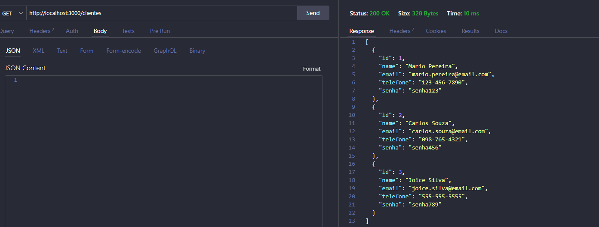

# Projeto Aula 08 — API REST com Node.js

## 1. Descrição do projeto

Este projeto foi desenvolvido como atividade prática do SENAI, com o objetivo de aplicar os conceitos de desenvolvimento backend utilizando JavaScript e Node.js.

A aplicação permite realizar operações CRUD (Create, Read, Update e Delete) para gerenciar clientes, pedidos, produtos e itens de pedidos. Os dados são armazenados em arquivos JSON.

## 2. Tecnologias utilizadas

- **Node.js:** ambiente de execução do JavaScript.
- **Express:** framework utilizado para criar o servidor e configurar as rotas.
- **JavaScript:** linguagem utilizada no desenvolvimento da aplicação.
- **JSON:** formato utilizado para armazenar os dados.
- **Thunder Client:** ferramenta utilizada para testar as requisições HTTP.
- **Visual Studio Code:** editor utilizado para desenvolver o projeto.

## 3. Estrutura do projeto

```text
aula08/
├── dados/
│   ├── clientes.json
│   ├── pedidos.json
│   ├── produtos.json
│   └── itens.json
├── src/
│   ├── controllers/
│   │   ├── cliente.js
│   │   ├── pedidos.js
│   │   ├── produtos.js
│   │   └── itens.js
│   └── routes.js
├── .gitignore
├── package.json
├── package-lock.json
├── server.js
└── README.md
```

## 4. Como executar o projeto

### Pré-requisitos

- Node.js instalado.
- Visual Studio Code instalado.

### Passos para iniciar

1. Abra a pasta do projeto no Visual Studio Code.
2. Abra o terminal integrado.
3. Instale as dependências, caso necessário:

```bash
npm install
```

4. Inicie o servidor:

```bash
node server.js
```

5. Acesse as rotas pelo navegador ou utilize o Thunder Client para realizar os testes.

**URL base:** `http://localhost:3000`

## 5. Rotas da API

As rotas abaixo representam as operações CRUD implementadas no projeto.

| Método HTTP | Rota | Operação |
|---|---|---|
| GET | `/clientes` | Listar clientes |
| POST | `/clientes` | Cadastrar cliente |
| PUT | `/clientes/:id` | Alterar cliente |
| DELETE | `/clientes/:id` | Excluir cliente |
| GET | `/pedidos` | Listar pedidos |
| POST | `/pedidos` | Cadastrar pedido |
| PUT | `/pedidos/:id` | Alterar pedido |
| DELETE | `/pedidos/:id` | Excluir pedido |
| GET | `/produtos` | Listar produtos |
| POST | `/produtos` | Cadastrar produto |
| PUT | `/produtos/:id` | Alterar produto |
| DELETE | `/produtos/:id` | Excluir produto |
| GET | `/itens` | Listar itens |
| POST | `/itens` | Cadastrar item |
| PUT | `/itens/:id` | Alterar item |
| DELETE | `/itens/:id` | Excluir item |

## 6. Funcionalidades

### Clientes
Permite cadastrar, consultar, alterar e excluir clientes.

### Pedidos
Permite cadastrar, consultar, alterar e excluir pedidos relacionados aos clientes.

### Produtos
Permite cadastrar, consultar, alterar e excluir produtos, contendo informações como nome e preço.

### Itens de pedidos
Permite cadastrar, consultar, alterar e excluir itens relacionados aos pedidos e aos produtos. O subtotal é calculado considerando o preço e a quantidade do item.

## 7. Testes realizados no Thunder Client

Nesta seção devem ser inseridas as capturas de tela das requisições realizadas durante os testes da API.

### 7.1 Teste GET — Consulta de dados

**Objetivo:** verificar se a API retorna os registros cadastrados.

**Rota de exemplo:** `GET http://localhost:3000/clientes`

**Captura de tela:**



### 7.2 Teste POST — Cadastro de dados

**Objetivo:** verificar se a API permite cadastrar novos registros.

**Rota de exemplo:** `POST http://localhost:3000/clientes`

**Captura de tela:**

Inserir aqui a imagem do teste POST.

### 7.3 Teste PUT — Alteração de dados

**Objetivo:** verificar se a API permite atualizar um registro existente.

**Rota de exemplo:** `PUT http://localhost:3000/clientes/1`

**Captura de tela:**

Inserir aqui a imagem do teste PUT.

### 7.4 Teste DELETE — Exclusão de dados

**Objetivo:** verificar se a API permite excluir um registro existente, respeitando as regras de validação do sistema.

**Rota de exemplo:** `DELETE http://localhost:3000/clientes/4`

**Captura de tela:**

Inserir aqui a imagem do teste DELETE.

### Observação sobre os testes

Os testes devem ser realizados com IDs e dados existentes no projeto. As capturas de tela devem mostrar a requisição, a rota utilizada e a resposta retornada pela API.

## 8. Considerações finais

O desenvolvimento deste projeto possibilitou praticar a criação de uma API REST com Node.js e Express, a organização do código em controllers e rotas, a manipulação de arquivos JSON e a realização de operações CRUD.

A atividade também contribuiu para compreender o funcionamento das requisições HTTP e o relacionamento entre clientes, pedidos, produtos e itens de pedidos.